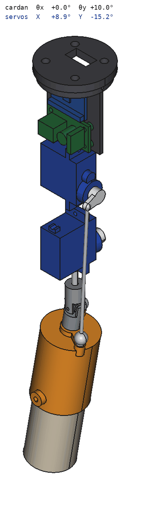
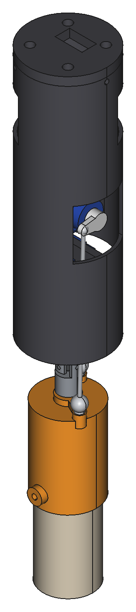
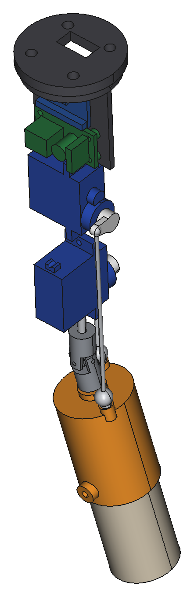
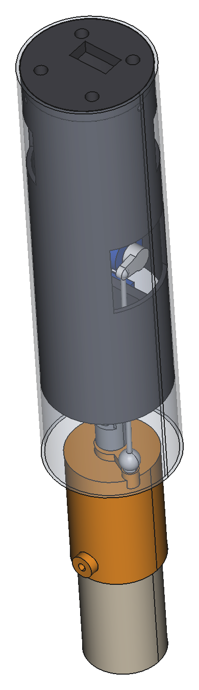

# Version compacte pour tube de 4 cm

Variante de [la version Ø76](README.md) qui tient dans un tube de Ø40 × 38 mm. La longueur n'est
pas limitée. Le modèle est dans `tvc_compact.py`, les exports dans `exports_compact/`.

| Module | Intérieur (θx = +8°, θy = −8°) | Dans le tube |
|---|---|---|
|  |  |  |

## Principe

Avec un moteur Ø24, il n'y a pas la place dans Ø38 pour un cardan à bagues autour du moteur.
Les choix sont donc différents de la version Ø76 :

- Le pivot est un mini-joint de cardan du commerce (Ø9, alésages Ø3) placé au-dessus du moteur.
  Le moteur est suspendu dessous.
- Les deux MG90S sont empilés, arbre radial, palonnier dans le plan de la coque.
- L'électronique est montée sur un support vertical au-dessus des servos.

Conséquence : le support moteur balaie un cône sous le pivot. Le tube doit s'arrêter au plus
15 mm sous le centre du joint de cardan. Le moteur et la moitié basse de son support restent
hors du tube.

## Caractéristiques

| | |
|---|---|
| Diamètre | Ø37,6 (tube supposé Ø40 ext. / Ø38 int., paramètres `tube_id`, `mod_r`) |
| Longueur | 222 mm de la buse à la platine, dont 147 mm au-dessus du bas du tube |
| Débattement | ±10° par axe, sans interférence sur les 9 poses testées, jeu mini 0,5 mm |
| Pivot | Mini-joint de cardan acier Ø9, 2 goupilles Ø3 × 14 |
| Transmission | Palonnier 7 mm, rotules à 12 mm de l'axe, biellettes de 39 et 75 mm |
| Pièces imprimées | 3 pièces, environ 52 g en PETG plein (hors moteur factice) |
| Interface banc | 4 inserts M3 sur Ø26, passage USB-C dans la platine |

## Cinématique

Les rotules ne sont pas sur les axes X et Y : chaque servo agit sur les deux axes.
Le firmware doit utiliser la cinématique inverse (`solve_servo`). Extrait du rapport :

| Pose | Servo X | Servo Y |
|---|---|---|
| θx = +1° | +1,68° | −0,77° |
| θy = +1° | +0,81° | −1,60° |
| θx = +10° | +17,8° | −6,8° |
| θy = +10° | +8,9° | −15,2° |

Autour du neutre, 1° de servo donne environ 0,6° au cardan, contre 0,42° pour la version Ø76.
La résolution est donc un peu moins fine (environ 0,3° pour une bande morte de 0,5°).

## Pièces imprimées

| STL | Pièce | Orientation |
|---|---|---|
| `bay` | Plancher porte-cardan, coque, platines des deux servos | Plancher sur le plateau (116 mm de haut) |
| `top` | Platine banc et support d'électronique | Platine sur le plateau |
| `motor_mount` | Support moteur | Capot en haut |
| `motor_d9` | Moteur factice | Debout (optionnel) |

## Nomenclature

| Qté | Désignation |
|---|---|
| 1 | Mini-joint de cardan acier Ø9, alésages Ø3, avec vis de pression |
| 2 | Goupille cylindrique Ø3 × 14 |
| 2 | Servo MG90S |
| 2 | Rotule à boule M2 et chape M2 |
| 2 | Tige M2 ou corde à piano Ø1,6 (entraxes 39,3 et 75,2 mm) |
| 1 | ESP32-C3 Super Mini, 1 GY-521, carte de distribution 26 × 14 mm |
| 4 | Insert laiton M3 (platine banc) |
| 3 | Vis M2 × 6 (platine dans la coque, radiales) |
| 4 | Vis M2 × 6 autotaraudeuses (pattes de servo) |
| 1 | Vis M3 nylon × 6 (maintien du moteur) |

## Montage

1. Emmancher une goupille Ø3 × 14 dans le plancher de la baie, par-dessous, et l'autre dans le
   bossage du support moteur.
2. Serrer le moyeu haut du joint de cardan sur la goupille du plancher, puis le moyeu bas sur celle
   du support moteur.
3. Visser les rotules M2 sur les bossages du support moteur.
4. Glisser les servos dans les fenêtres des platines et les visser. Centrer à 1500 µs, monter les
   palonniers dans l'axe des fenêtres de la coque, puis régler les biellettes pour un moteur dans
   l'axe.
5. Câbler l'électronique sur le support, insérer la platine dans la coque et la fixer avec les
   3 vis radiales.
