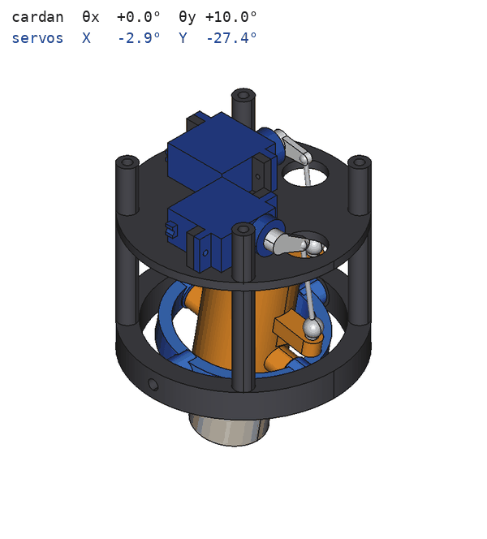

# CAO – Module TVC de banc (moteur D9 factice)

Prototype de poussée vectorielle sur 2 axes pour un moteur de classe D (Ø24 × 70 mm),
destiné au banc d'essai. Toute la géométrie est générée par un script FreeCAD paramétrique :
[`tvc_module.py`](tvc_module.py).


Le module en action : le moteur décrit un cône de 10°, avec les angles de servo issus de la
cinématique inverse (platine et plateau avionique masqués) :



| Baie servos | Cardan incliné (θx = +8°, θy = −8°) |
|---|---|
|  |  |

## Caractéristiques

| | |
|---|---|
| Encombrement | Ø76 × 89 mm (platine banc → bas du châssis), moteur dépassant de 30 mm |
| Débattement | ±10° sur chaque axe, vérifié sans interférence sur les 9 poses extrêmes |
| Pivots | 4 roulements MR63ZZ + goupilles Ø3 : pas de jeu ni de frottement dans le cardan |
| Actionneurs | 2 × MG90S couchés au-dessus du cardan, biellettes M2 à rotules |
| Démultiplication | bras 26 mm / palonnier 11 mm = **2,36:1** → ~2,4° de servo par degré de cardan |
| Électronique | ESP32-C3 Super Mini, MPU6050 (GY-521) centré sur l'axe, carte de distribution 5 V |
| Interface banc | 4 × M4 sur Ø44 + trou central Ø6,5 sur la platine supérieure |
| Masse imprimée | ~107 g (6 pièces, PETG à 100 %), hors moteur factice |

### Repère et cinématique

Z vers l'avant (buse vers −Z), origine au centre du cardan, au milieu du moteur.

- **Axe X** (cardan interne : support moteur ↔ bague) : piloté par le **servo X**, biellette en +Y.
- **Axe Y** (cardan externe : bague ↔ châssis) : piloté par le **servo Y**, biellette en +X.

Le script résout la cinématique exacte (biellette de longueur fixe entre le trou du palonnier et la
rotule) et affiche la correspondance angle du cardan → angle du servo :

| θ cardan | −10° | −5° | −1° | +1° | +5° | +10° |
|---|---|---|---|---|---|---|
| servo X (θx) | −27,4° | −12,6° | −2,39° | +2,33° | +11,1° | +20,7° |
| servo Y (θy) | +20,7° | +11,1° | +2,33° | −2,39° | −12,6° | −27,4° |

Autour du neutre, 1° de servo ≈ 0,42° de cardan. Avec un MG90S (bande morte ≈ 5 µs ≈ 0,5°),
la résolution au cardan est donc d'environ **0,2°**. La loi n'est pas linéaire aux extrémités et les
deux axes sont légèrement couplés (à θx = θy = +10° : servo X +16,3°, servo Y −29,6°). Le firmware
devra utiliser la cinématique inverse (fonction `solve_servo` du script) ou une table de correspondance
plutôt qu'un simple gain.

## Utilisation du script

```bash
# Génère le .FCStd, le STEP d'assemblage, les STL des pièces imprimées et le rapport
freecadcmd cad/tvc_module.py

# Pose particulière du cardan pour l'export / la visualisation
TVC_THETA_X=8 TVC_THETA_Y=-5 freecadcmd cad/tvc_module.py

# Rendus PNG (interface graphique nécessaire ; xvfb-run sur un serveur)
xvfb-run -s "-screen 0 1600x1200x24" freecad cad/render_views.py

# GIF animé (balayage circulaire ±10°) : images FreeCAD puis assemblage avec Pillow
xvfb-run -s "-screen 0 1600x1200x24" freecad cad/render_gif.py
python3 cad/make_gif.py
```

- **Dans FreeCAD** : *Macro → Macros… → Exécuter* sur `tvc_module.py`. Les pièces sont colorées et
  rangées dans les groupes *Pieces_imprimees*, *Quincaillerie* et *Electronique*.
- **Via un MCP FreeCAD** (p. ex. `freecad-mcp`) : passer le contenu du fichier à l'outil
  `execute_code`. Le script n'utilise que l'API Python standard `FreeCAD` / `Part`.
- Toutes les cotes sont dans le dictionnaire `P` en tête de fichier. Après modification, relancez le
  script : la vérification des interférences (`run_checks`) et le rapport sont refaits.

Les fichiers générés sont dans [`out/`](out/) : `tvc_module.FCStd`, `tvc_module_assembly.step`,
`stl/*.stl` et `report.txt` (cinématique, interférences, jeux mini, volumes).

## Pièces imprimées

| Fichier | Pièce | Remarques d'impression |
|---|---|---|
| `motor_mount.stl` | Support moteur (cardan interne) | Debout, capot en haut. PETG, 4 périmètres. Bras en porte-à-faux : supports « arbre ». |
| `gimbal_ring.stl` | Bague de cardan | À plat. Logements de roulements Ø6 : faire un essai d'ajustement serré. |
| `frame.stl` | Châssis inférieur + 4 colonnes | Anneau à plat, colonnes vers le haut. Inserts M3 en tête de colonne. |
| `servo_deck.stl` | Plateau servos + poteaux de pattes + colonnes | Plaque à plat. |
| `avionics_deck.stl` | Plateau avionique | Plaque à plat. |
| `top_plate.stl` | Platine banc + entretoises | Retournée (face banc sur le plateau). |
| `motor_d9.stl` | Moteur D9 factice (gabarit Ø24 × 70) | Optionnel : un vieux corps de moteur convient aussi. |

Ajustements prévus au modèle (à corriger dans `P` selon votre imprimante) : alésage moteur Ø24,4,
logements de roulements Ø6,0 (serrage), trous de goupille Ø3,0 (serrage), passages M3 Ø3,4,
logements d'inserts Ø4,0.

## Nomenclature

| Qté | Désignation | Rôle |
|---|---|---|
| 1 | ESP32-C3 Super Mini | Contrôleur |
| 1 | Module GY-521 (MPU6050) | Centrale inertielle |
| 2 | Servo MG90S (pignons métal) | Actionneurs X / Y |
| 4 | Roulement MR63ZZ 3×6×2,5 | Pivots du cardan |
| 4 | Goupille cylindrique Ø3 × 10 (ISO 8734 / DIN 6325) | Axes de pivot (emmanchés dans la pièce mobile) |
| 4 | Rondelle de calage 3×6×0,5 (DIN 988) | Jeu axial entre pièce mobile et roulement |
| 2 | Rotule à boule M2 + chape à rotule M2 | Liaison biellette / bras |
| 2 | Tige filetée M2 ou corde à piano Ø1,6, ~35 mm | Biellettes (entraxe 29,6 mm, réglable) |
| 4 | Vis M3 × 45 DIN 912 | Serrage de l'empilage complet |
| 4 | Insert laiton M3 (Ø4 × 5,7) | Têtes des colonnes du châssis |
| 1 | Vis M3 nylon × 6 | Maintien radial du moteur |
| 4 | Vis M2 × 6 autotaraudeuses | Pattes de servo |
| 2 + 4 | Vis M2,5 × 8 / M2 × 6 autotaraudeuses | IMU / carte de distribution |
| 1 | Plaque à pastilles 20 × 28 mm | Carte de distribution |
| 1 | Bornier 2 points pas 5 mm | Entrée 5 V du banc |
| 1 | Condensateur 330 µF 10 V (Ø6,3 × 7,7) | Découplage servos |
| 2 | Barrette mâle 3 broches | Connecteurs servos |

## Montage

1. **Support moteur → bague** : glisser le support moteur dans la bague *par le haut* (les bossages
   d'axe X passent dans l'alésage Ø44). Presser les 2 roulements dans la bague (faces intérieures),
   placer les cales, puis emmancher les goupilles depuis l'extérieur à travers les trous Ø4 jusque
   dans les bossages du support moteur.
2. **Bague → châssis** : descendre le sous-ensemble entre les colonnes. Presser les 2 roulements
   d'axe Y dans les lamages intérieurs du châssis, placer les cales, puis emmancher les goupilles
   depuis l'extérieur jusque dans les bossages de la bague. Vérifier que le cardan tourne librement.
3. **Rotules** : visser les rotules M2 dans les bras (+X et +Y) du support moteur.
4. **Plateau servos** : visser les servos sur les poteaux, palonniers simples à l'horizontale vers
   la biellette au neutre (centrer le servo à 1500 µs avant de monter le palonnier). Monter les
   biellettes et régler leur longueur pour un moteur parfaitement axial.
5. **Empilage** : plateau servos sur les colonnes, plateau avionique, platine banc, puis les 4 vis
   M3 × 45 depuis le haut, dans les inserts des colonnes.
6. **Moteur** : insérer le moteur D9 factice par le bas jusqu'en butée sous le capot, puis serrer la
   vis nylon M3.

## Électronique et câblage

Le module est alimenté en **5 V par le banc**, sur le bornier de la carte de distribution
(prévoir ≥ 2 A : chaque MG90S peut tirer ~0,7 A en pointe). L'ESP32-C3 reste branché en USB-C
pour la programmation et les logs. Le connecteur est accessible par le côté, entre le plateau
avionique et la platine.

| ESP32-C3 Super Mini | Vers |
|---|---|
| 5V | +5 V de la carte de distribution |
| GND | GND commun (servos, IMU, banc) |
| 3V3 | VCC du GY-521 |
| GPIO6 | SDA du GY-521 |
| GPIO7 | SCL du GY-521 |
| GPIO3 | Signal servo X |
| GPIO4 | Signal servo Y |

Proposition qui évite les broches de démarrage (GPIO2/8/9). Le MPU6050 est centré sur l'axe du
module, ses axes alignés sur X / Y.

> Le firmware actuel (`src/VectorControlSW`) cible encore une carte NodeMCU-32S et un accéléromètre
> MMA8452Q. Il faudra le porter sur ESP32-C3 + MPU6050 et y intégrer la cinématique inverse ci-dessus.
