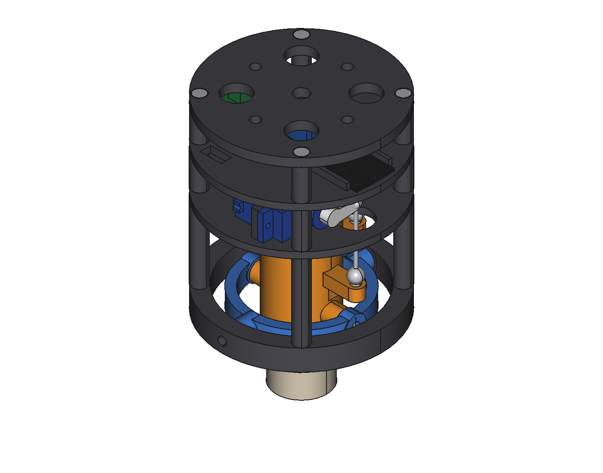
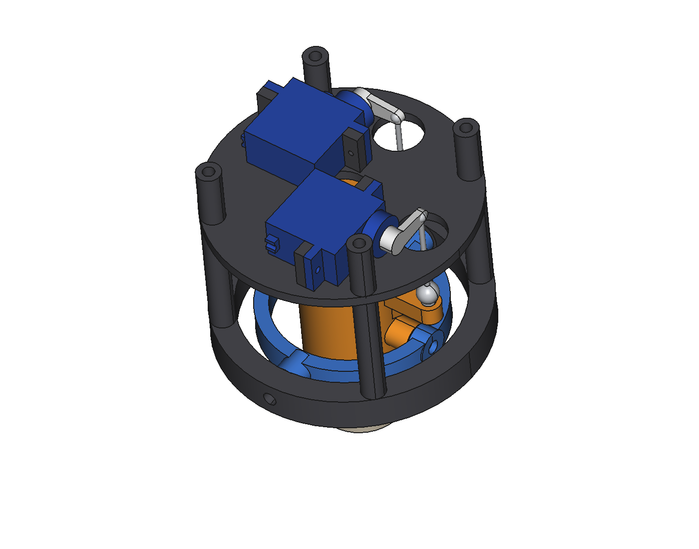
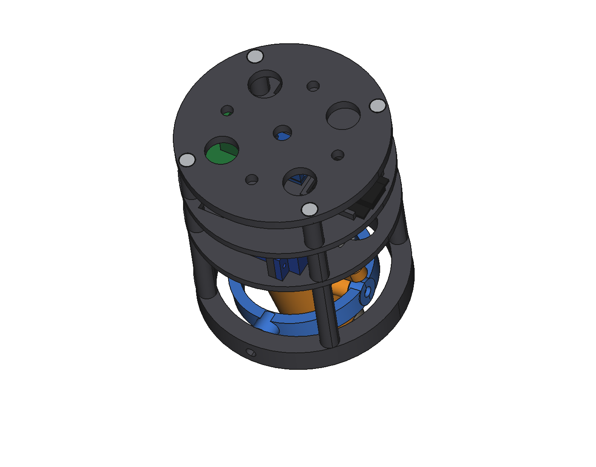

# CAO

Modèle FreeCAD paramétrique du prototype de banc : cardan 2 axes pour un moteur D9 factice
(Ø24 × 70 mm), deux servos MG90S, électronique et platine de fixation au banc.



| Baie servos | Cardan incliné (θx = +8°, θy = −8°) |
|---|---|
|  |  |

## Fichiers

| Fichier | Contenu |
|---|---|
| `tvc_module.py` | Modèle, cinématique, vérification des interférences, exports |
| `render_views.py` | Rendus PNG dans `docs/img/` |
| `render_gif.py`, `make_gif.py` | GIF de démonstration |
| `exports/` | `tvc_module.FCStd`, `tvc_module_assembly.step`, `stl/`, `report.txt` |

## Utilisation

```bash
# Modèle + exports
freecadcmd cad/tvc_module.py

# Pose du cardan pour l'export (degrés)
TVC_THETA_X=8 TVC_THETA_Y=-5 freecadcmd cad/tvc_module.py

# Rendus (interface graphique nécessaire, xvfb-run sur un serveur)
xvfb-run -s "-screen 0 1600x1200x24" freecad cad/render_views.py
xvfb-run -s "-screen 0 1600x1200x24" freecad cad/render_gif.py && python3 cad/make_gif.py
```

Le script utilise uniquement l'API Python `FreeCAD` / `Part`. Il fonctionne aussi en macro dans
FreeCAD ou via l'outil `execute_code` d'un MCP FreeCAD. Les cotes sont regroupées dans le
dictionnaire `P` en tête de fichier.

## Caractéristiques

| | |
|---|---|
| Encombrement | Ø76 × 89 mm, moteur dépassant de 30 mm sous le châssis |
| Débattement | ±10° par axe, sans interférence sur les 9 poses testées |
| Pivots | 4 roulements MR63ZZ, goupilles Ø3 × 10, cales 3 × 6 × 0,5 |
| Transmission | Biellettes M2 à rotules, bras 26 mm / palonnier 11 mm (rapport 2,36) |
| Interface banc | 4 × M4 sur Ø44, trou central Ø6,5 |
| Pièces imprimées | 6 pièces, environ 107 g en PETG plein |

Repère : Z vers l'avant (buse vers −Z), origine au centre du cardan.
L'axe X (support moteur / bague) est piloté par le servo X, biellette en +Y.
L'axe Y (bague / châssis) est piloté par le servo Y, biellette en +X.

Autour du neutre, 1° de servo donne environ 0,42° au cardan. La table complète est dans
`exports/report.txt` et dans [firmware/README.md](../firmware/README.md).

## Pièces imprimées

| STL | Pièce | Orientation |
|---|---|---|
| `motor_mount` | Support moteur (cardan interne) | Debout, capot en haut, supports sous les bras |
| `gimbal_ring` | Bague de cardan | À plat |
| `frame` | Châssis inférieur et colonnes | Anneau sur le plateau |
| `servo_deck` | Plateau servos | À plat |
| `avionics_deck` | Plateau avionique | À plat |
| `top_plate` | Platine banc | Face banc sur le plateau |
| `motor_d9` | Moteur factice | Debout (optionnel) |

Cotes à ajuster selon l'imprimante : alésage moteur Ø24,4, logements de roulements Ø6,0,
trous de goupilles Ø3,0, passages M3 Ø3,4, inserts Ø4,0.

Cotes reprises de valeurs courantes, à vérifier sur les composants : MG90S, GY-521
(entraxe des trous), ESP32-C3 Super Mini.

## Nomenclature

| Qté | Désignation |
|---|---|
| 1 | ESP32-C3 Super Mini |
| 1 | Module GY-521 (MPU6050) |
| 2 | Servo MG90S |
| 4 | Roulement MR63ZZ 3 × 6 × 2,5 |
| 4 | Goupille cylindrique Ø3 × 10 |
| 4 | Rondelle de calage 3 × 6 × 0,5 (DIN 988) |
| 2 | Rotule à boule M2 et chape M2 |
| 2 | Tige filetée M2, environ 35 mm (entraxe 29,6 mm) |
| 4 | Vis M3 × 45 DIN 912 |
| 4 | Insert laiton M3 |
| 1 | Vis M3 nylon × 6 (maintien du moteur) |
| 4 | Vis M2 × 6 autotaraudeuses (pattes de servo) |
| 2 | Vis M2,5 × 8 autotaraudeuses (IMU) |
| 4 | Vis M2 × 6 autotaraudeuses (carte de distribution) |
| 1 | Plaque à pastilles 20 × 28 mm |
| 1 | Bornier 2 points, pas 5 mm |
| 1 | Condensateur 330 µF 10 V, Ø6,3 × 7,7 |
| 2 | Barrette mâle 3 broches |

## Montage

1. Glisser le support moteur dans la bague par le haut. Presser les roulements d'axe X dans la
   bague, poser les cales, emmancher les goupilles depuis l'extérieur.
2. Descendre l'ensemble dans le châssis. Presser les roulements d'axe Y dans le châssis, poser les
   cales, emmancher les goupilles depuis l'extérieur.
3. Visser les rotules M2 dans les bras du support moteur.
4. Fixer les servos sur le plateau. Centrer les servos à 1500 µs avant de monter les palonniers
   à l'horizontale. Régler la longueur des biellettes pour un moteur dans l'axe.
5. Empiler plateau servos, plateau avionique et platine, puis serrer les 4 vis M3 × 45 dans les
   inserts des colonnes.
6. Insérer le moteur par le bas jusqu'en butée et serrer la vis nylon.
